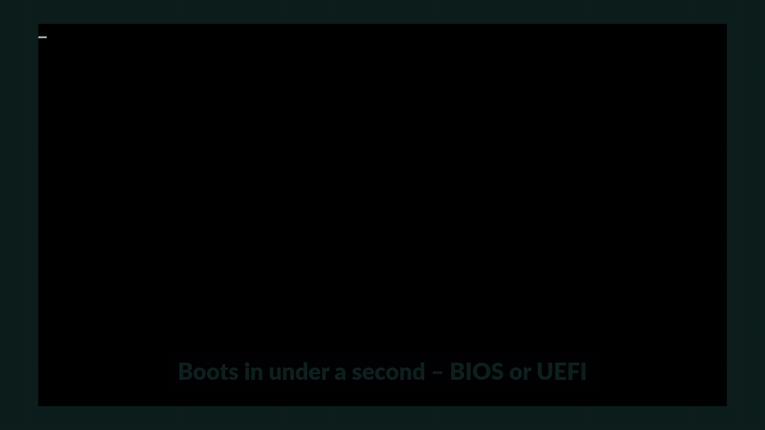
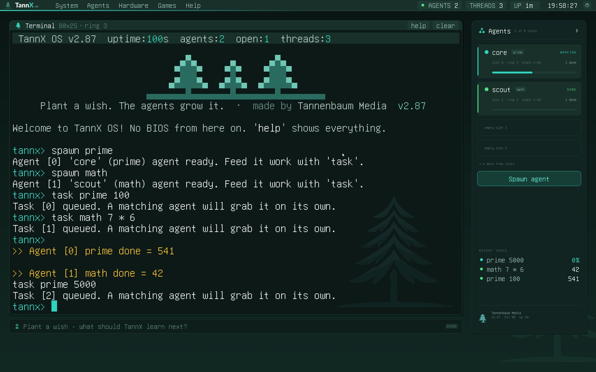
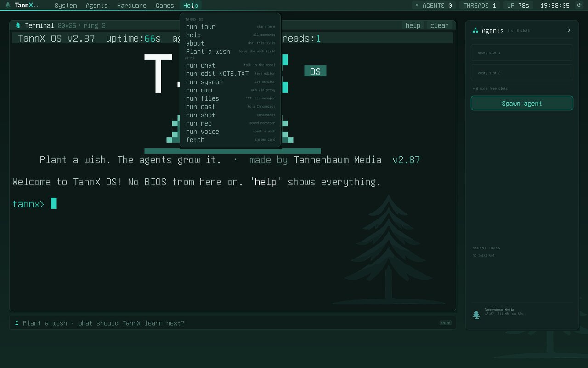
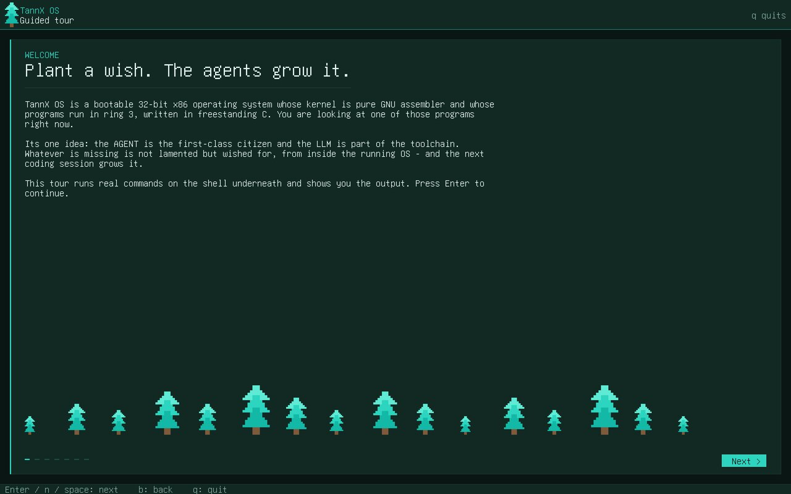
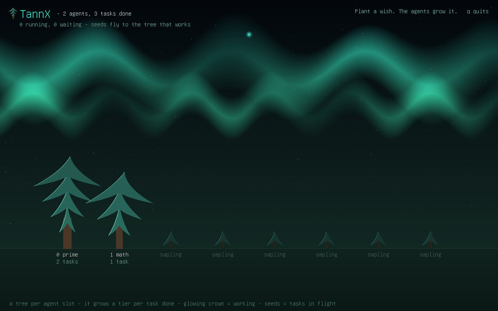
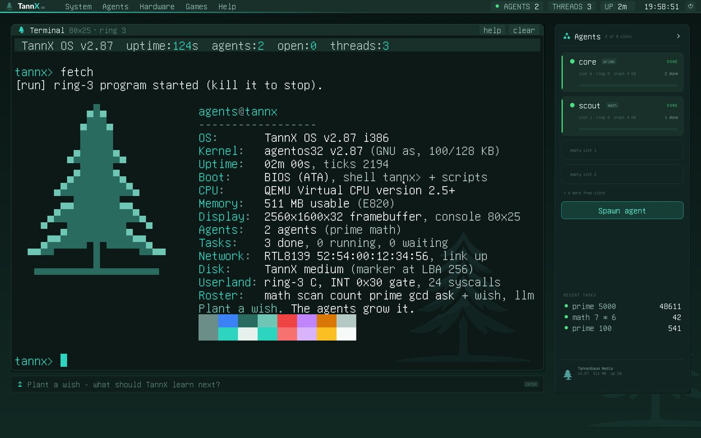
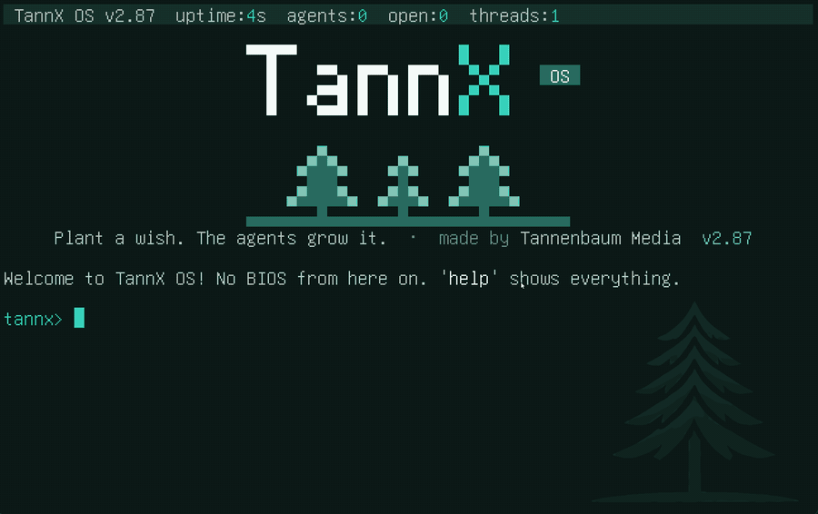
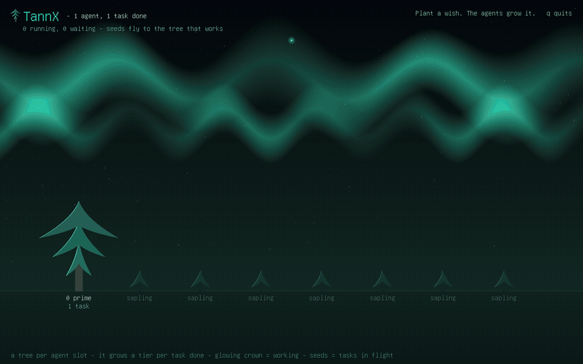

# TannX OS

[](https://github.com/tannenbaum-media/tannx/actions/workflows/ci.yml)
[](LICENSE)

**TannX OS - a bootable x86 OS written in assembly and grown by AI agents.
Plant a wish. The agents grow it.**

TannX OS is a bootable x86 operating system whose kernel is pure GNU
assembler (no compiler, no libc, no BIOS calls after boot) and whose
userland is freestanding C in ring 3. Its one idea: the agent is the
first-class citizen and the LLM is part of the toolchain. What is
missing is not lamented but *wished for* from inside the running OS, and
the next LLM session builds it. Since v2.46 that is literal: the OS can
ask a model for a program and run it, on the spot, from its own disk.





| | |
|---|---|
|  |  |
|  |  |
|  |  |

Runs in QEMU (BIOS, UEFI, PXE) and on real hardware - verified on a
Haswell desktop and a dual-socket Xeon Gold server (UEFI).

**Try first: `run tour`** - boot it (`make run32`) and type `run tour` (or
pick *Help > run tour* in the menu bar) for a guided tour that runs real
agent commands live.

## How it works

1. **Wish.** At the prompt you type what is missing: `tannx> wish a command that prints a fir tree`.
   The wish is stored on the OS's own disk.
2. **Build.** A Claude Code session on the host picks the wish up, writes the
   feature into the kernel or the userland, adds a test and runs the
   headless QEMU gate.
3. **Rebuild.** If the gate is green the change lands on its own `wish/*`
   branch and the OS reboots with the new feature - you review and merge.

## Build it with Claude Code

Type what software you want; [Claude Code](https://docs.claude.com/en/docs/claude-code)
builds it into the OS and reboots it ([docs/CLAUDE-CODE.md](docs/CLAUDE-CODE.md)):

```bash
curl -fsSL https://claude.ai/install.sh | bash   # install Claude Code
claude                                          # log in once, then /exit
make wish-loop                                  # boot TannX OS in QEMU, wait for wishes
#   tannx> diskon
#   tannx> wish a command that prints a fir tree
# -> branch wish/<slug>, make test32 green, VM reboots with the new command
```

Everything runs locally; each wish lands on its own `wish/*` branch for
you to review - nothing is merged or pushed.

## 60-second demo

```
tannx> llmscript 6 find the 100th prime and celebrate with a beep
--- the LLM wrote: ---
spawn prime
task prime 100
sleep 40
tasks
beep
echo 100th prime found
----------------------
llmscript: saved to slot 6 - run it:  script 6
tannx> script 6
>> Agent [0] prime done = 541
Beep!
100th prime found
```

A real model wrote that script over the wire; the OS persisted it
through its own disk driver and executed it - ring-3 agents, scheduler,
fault isolation and all.

## Quickstart

```bash
# Debian/Ubuntu. The kernel needs only binutils; gcc builds the ring-3 userland.
sudo apt install build-essential binutils python3 qemu-system-x86 mtools dosfstools ovmf
# for the full test gate as well:
sudo apt install curl netcat-openbsd tcpdump imagemagick
# optional: python3-pil (encodes the demo video clip; without it the player shows a built-in demo)

make              # build agentos32.img (kernel + ring-3 blob + video clip)
make run32        # boot the live image in QEMU; saves and wishes persist across rebuilds
make test-all     # the full headless gate: 49 QEMU suites, all green or no commit
```

Just want to look? Build once and boot the image directly:

```bash
make && qemu-system-i386 -drive format=raw,file=agentos32.img -vga std -m 512 \
  -netdev user,id=n0 -device rtl8139,netdev=n0
```

Ready-made boot images (BIOS/UEFI hybrid for a USB stick) are attached
to the [GitHub releases](https://github.com/tannenbaum-media/tannx/releases).

**Try first: `run tour`** - a guided tour in the brand style that explains
the OS while it runs real agent commands live and shows you their output.
Enter steps forward, q leaves. Then type `help`, or pick from:

```
run tour                                   # the guided tour (start here)
spawn math; task math 1337 * 42; tasks     # an agent in ring 3 does the work
spawn prime; task prime 100; waittask 0    # join on a task instead of guessing
dump 0                                     # page fault in the shell - caught
task scan b8000                            # an agent touches VGA RAM - it dies, the OS does not
diskon; wish build me a tetris game        # persist a wish; 'make wishes' harvests it
gui                                        # the Dark Glass desktop compositor
fetch                                      # neofetch-style card: the fir + what the OS knows about itself
forest                                     # watch the agents as a growing, glowing forest (q quits)
run sysmon                                 # live monitor: agents, tasks, cpu share (q quits)
run edit NOTE.TXT                          # full-screen editor (Ctrl+S saves, Ctrl+Q quits)
run www example.com                        # text web browser (needs the host proxy)
run files                                  # file manager for a FAT disk / USB stick
run shot                                   # screenshot -> SHOT0001.BMP (or to the proxy)
run cast https://youtu.be/...              # stream to a Chromecast via the proxy
run rain                                   # the agent rain screensaver
```

To talk to a model, run the proxy on the host (`./llm-proxy.py --mock`
for canned answers, or with `ANTHROPIC_API_KEY` set) and type `llm hello`
in the OS - or `run chat` for a full-screen conversation. The same proxy
is the OS's door to the web (`run www`), to a Chromecast (`run cast`;
needs `pip install pychromecast` on a host in the TV's LAN, and
`--bind 0.0.0.0` only when the OS runs on real hardware) and a drop box
for screenshots (`run shot` without a FAT disk). `make run-uefi` boots
the same OS under OVMF; `make run-pxe` boots it over QEMU's built-in
TFTP with no disk at all.

## The wish/LLM loop

```
   +---------------------------- TannX OS (QEMU or real PC) ---------------------------+
   |  wish <text>  --> wish slot on disk (LBA 265-272)                                 |
   |  llm <q>, llmscript <slot> <task>, spawn ask, autopilot                           |
   |        |  plain HTTP over the OS's own ring-3 TCP/IP stack                       |
   +--------|-------------------------------------------------------------------------+
            v                                                      ^
   llm-proxy.py on the host (127.0.0.1:4080 by default)            |  answer / script
            |  TLS to the model API, or a local model              |
            v                                                      |
         the LLM  ------------------------------------------------ +

   make wishes  --> harvests the wish slots --> an LLM coding session builds
                    the feature, runs make test-all, commits  --> next boot has it
```

- `wish <text>` stores a wish on disk; `make wishes` harvests it and the
  next LLM session builds it (how most of the OS came to be).
- `llm [@backend] <question>` asks a model from the shell through the
  host proxy (`@api`, `@openai`, `@ollama`; `@list` shows what is live).
- `llmscript <slot> <task>` makes the model write a TannX OS script; the
  OS stores it in an AgentFS slot and `script <slot>` runs it.
- `spawn ask` is an LLM *agent* on the real agent ABI: it claims
  `task ask <slot>` work, asks the model, writes the answer into the slot.
- `autopilot [mission]` closes the loop: ask the model what to do next,
  do it, ask again. ESC or Ctrl+C stops it.

## What is inside (v2.87)

- **Kernel in GAS** (`agentos32.S`, ~16.8k lines): GDT/IDT, paging with
  NULL guard and fault isolation (#PF/#GP/#UD kill one agent, never the
  box), preemptive round-robin multitasking, opt-in **SMP** (INIT-SIPI,
  per-core scheduler, spinlocks around the task tables), one syscall
  gate (INT 0x30), kernel heap, dmesg ring, E820/SMBIOS/cpuid, CPU and
  RAM self-tests, a kernel watchdog for runaway agents.
- **Agents in ring 3**: typed workers (math/scan/count/prime/gcd + the
  LLM agent `ask`), claim/progress/finish lifecycle, pipelines (`task
  count @0`), results pushed over UDP, persisted across reboots.
- **In-kernel drivers**: VGA text + VBE/GOP framebuffer with own font and
  graphics primitives, PS/2 keyboard and mouse, EHCI USB HID, 16550
  serial, PIT/RTC, ATA PIO, **AHCI/SATA + ATAPI**, RTL8139/RTL8168/e1000/
  **virtio-net**, AC97, PC speaker.
- **Ring-3 C userland** (`user/`, ~5.4k lines, own tiny libc): TCP/IP
  stack (ARP, IPv4, ICMP, DHCP, DNS, TCP, HTTP client) and an **HTTP
  server** with a live status page and file upload; **NVMe**, **xHCI USB
  mass storage**, **virtio-blk** and **virtio-gpu** drivers; a shared
  FAT16/FAT32 read+write layer (bare VBR, MBR or GPT); **Intel HDA audio
  with playback AND capture** (a shared ring-buffer engine, microphone/
  line-in via the codec's ADC) behind a **recorder** (`run rec`: level
  meter, scrolling waveform, playback, WAV to the FAT disk), a playable
  **synthesizer** (`run synth`: two octaves on the keyboard, four
  waveforms, ADSR, oscilloscope), a **voice wish** (`run voice`: speak,
  the host proxy transcribes with Whisper, `script 7` plants the wish)
  and HDA system sounds (`beep`, optional boot chime);
  the **Dark Glass desktop compositor** (windows, agent panel, clock,
  wish console; renders via virtio-gpu or the firmware framebuffer);
  snake and space invaders; an M-JPEG player with its own baseline JPEG
  decoder.
- **`fetch`**: a neofetch-style system card - the fir in teal block art
  next to version, kernel budget, uptime, boot path, cpuid, E820 RAM,
  display mode, agents and tasks, NIC, disk, tagline and palette strip.
- **`forest`**: the agent table as a living forest - a fir per slot that
  grows a tier per finished task, glowing crowns for busy agents, seeds
  flying to the tree that works, aurora and stars; dirty-rect rendering.
- **Full-screen programs** (`user/ui.c` toolkit, TannX look):
  `run chat` talks to the model in message bubbles over the same proxy
  path as `llm`, with scrollback and a proxy status chip (mock-aware).
  `run edit <file>` is a nano-like editor (arrows, Home/End, PgUp/PgDn,
  Ctrl+S/Ctrl+Q) that saves onto a FAT volume (virtio-blk/NVMe/USB) or,
  without one, into an AgentFS slot a `script` can run.
  `run sysmon` is a live monitor: agent roster with state and done counts,
  the task queue, ring-3 heap, NIC link/rx, and a scrolling graph of the
  CPU share the agents hold, measured from the monitor's own tick deltas.
- **Apps for people** (`user/tour.c www.c files.c shot.c cast.c rain.c`,
  one shared framebuffer toolkit `user/dui.c`): the **guided tour**
  (`run tour`, runs real commands through the shell and reads the results
  back); a **text web browser** (`run www <url>`: the host proxy fetches
  over HTTPS, strips HTML to numbered-link text, refuses private
  addresses); a **file manager** for the FAT volume (`run files`: sizes,
  free space, viewer, delete); **screenshots** (`run shot` writes a BMP to
  the FAT volume or streams it to the proxy, which saves a PNG);
  **Chromecast** (`run cast`: YouTube and http(s) media to a TV on the
  host's LAN, `pip install pychromecast` on the host); and the **agent
  rain** screensaver (`run rain`). Two syscalls carry them: `SYS_FGRAB`
  (an app owns keyboard + framebuffer; the same grab as `SYS_KBGRAB`) and
  `SYS_SHELL` (type a line into the shell).
- **Script engine**: `script <slot>` runs slot text as commands; `sleep`,
  `if`, `repeat`, two registers (`set`/`setb`, `$`/`#`), `waittask`,
  `waitall`, `wait`; `llmscript` lets the model write them.
- **Boot paths**: BIOS (two-sector-batch Stage 1), **UEFI** (hand-laid
  PE32+ loader, no compiler), one **hybrid USB stick** for both, and
  **PXE** network boot with a no-stick deploy loop.
- **Persistence**: AgentFS slots, wish slots and task results on the
  OS's own medium; RAM-backed slots on a foreign or absent disk so the
  loop runs on a diskless machine without ever writing someone else's
  disk.

## Sound

```
run rec            recorder: R record/stop, P play, S save REC.WAV (virtio-blk FAT), Q quit
run rec test       same with a built-in test signal + serial diagnostics (the gate)
run synth          synthesizer: z..m / q..p play two octaves, TAB waveform, [ ] envelope,
                   - = octave, ESC quit; 'run synth demo' plays a score by itself
run voice [secs]   record, POST the WAV to the proxy's /stt, stage "wish <transcript>"
                   in slot 7; the whole loop in one line:  run voice; wait; script 7
beep               through the HDA codec when a controller is present (PC speaker otherwise)
make CHIME=1       kernel plays a short boot chime (off by default: the gate stays silent)
```

Speech-to-text lives on the host: `llm-proxy.py` answers `/stt` with
`faster_whisper` or `whisper` if either Python module is installed
(`STT_MODEL`, default `base`), forwards to any HTTP service in `STT_URL`,
or returns a clear `STT error` - and `--mock` returns a fixed transcript
for the tests. QEMU with a **real microphone and speakers**:

```bash
qemu-system-i386 -drive format=raw,file=agentos32-live.img \
  -audiodev pa,id=a0 -device intel-hda -device hda-duplex,audiodev=a0 \
  -netdev user,id=n0 -device rtl8139,netdev=n0      # (alsa/pipewire/sdl work too)
```

`-audiodev none` (what the gate uses) still clocks both DMA engines at
48 kHz but captures silence, which is why the test modes inject a signal.

## Bare metal

The OS has booted and been driven on a real Haswell desktop over BIOS,
UEFI and PXE, and boots to the desktop over UEFI on a dual-socket Xeon
Gold server (Supermicro board, AMI firmware), including the RTL8168 NIC, AHCI/ATAPI, USB keyboard and
mouse, the compositor and the full LLM loop on a diskless box. What was
verified on hardware versus QEMU only, how to write the stick, set up
PXE and get telemetry back: [docs/BARE-METAL.md](docs/BARE-METAL.md).

## Security notice

TannX OS is a lab OS with a **trusted-LAN, trusted-ring-3** model: no
TLS, no authentication, and ring-3 programs may drive PCI devices by
design. The default build contains **no remote control**; the UDP
control channel (EXEC/REBOOT/...) exists only in `make REMOTE_CTL=1`
builds for an isolated lab network. The host proxy binds to localhost by
default. Read [SECURITY.md](SECURITY.md) before putting it on a network
you do not own.

## Tests

`make test-all` runs 49 headless QEMU suites: hybrid BIOS+UEFI boot, SMP
smoke, NIC + pcap, PXE diskless boot, AHCI + ATAPI, userspace TCP/HTTP
against a host server, httpd, the LLM loop with a mock proxy, llmscript
and autopilot end to end, the script engine, AC97/HDA DMA progress,
NVMe/xHCI/virtio-blk/virtio-gpu, FAT16/32 round-trips verified with
mtools, the compositor, the fetch card, the agent forest, chat, editor
and monitor via screendumps (the editor's file is read back on the host
with mtools), recorder/synth/voice on an emulated HDA codec, the tour /
browser / file manager / screenshot / Chromecast / rain apps (mock proxy,
mtools, screendumps), and more. Every suite drives the OS over its serial
console; nothing is mocked inside the OS.

## Built by LLMs

The kernel and the userland were written by LLM coding sessions -
Anthropic's Claude through Claude Code, with some work done by OpenAI
Codex - directed, reviewed and tested on real hardware by the project
owner. The wish loop was the method: the owner (or the OS itself) wished,
a session built, the gate decided. `docs/HISTORY.md` keeps the reasoning
and the mistakes; the code comments are written for the next session
that has to understand them. The project is honest about what was
verified where: QEMU gates everything, hardware verified what
`docs/BARE-METAL.md` says and nothing more.

## Repository map

| Path | What |
|---|---|
| `agentos32.S` | the kernel, one file |
| `agentos-uefi.S` | UEFI stage-0: hand-laid PE32+, long-mode to protected-mode descent |
| `pxe_stage1.S` | 512-byte diskless Stage 1 for PXE |
| `user/` | ring-3 C: libc, net stack, httpd, drivers, compositor, games, JPEG/video |
| `llm-proxy.py`, `proxy_ext.py` | host-side proxy between the OS and the LLMs; `/fetch`, `/cast`, `/shot` extras |
| `test*.sh`, `test.sh` | the headless QEMU gate (`make test-all`) |
| `tools/lan/` | lab scripts for real hardware (PXE server, remote control, autopilot monitor) |
| `tools/claude/` | the Claude Code wish loop: `wish-loop.sh`, the build hook `build-wish.sh`, its e2e test |
| `wishes.sh`, `wish-bridge.sh` | harvest wishes from the live images or over a serial line |
| `CLAUDE.md` | the operating manual every LLM session works by |
| `docs/ARCHITECTURE.md` | memory map, ABI, iron rules, pitfalls, lessons |
| `docs/BARE-METAL.md` | stick, UEFI, PXE, serial, what was verified on hardware |
| `docs/HISTORY.md` | the development chronicle and the wish log |
| `MANIFESTO.md`, `ROADMAP.md` | what it is / is not, and what is open |
| `SECURITY.md`, `CONTRIBUTING.md`, `THIRD_PARTY.md`, `LICENSE` | the usual |

## License

GNU General Public License v3.0 or later (GPL-3.0-or-later), Copyright (c)
2026 Tannenbaum Media. See [LICENSE](LICENSE). Modified versions you
distribute must stay open under the same license.

The names "TannX" / "TannX OS" and the Tannenbaum Media fir-tree
logo are trademarks of Tannenbaum Media and are not covered by the GPL: you
may use the code, but please do not ship forks under this name or logo.
Third-party material (console font glyphs, the Lato font used to render the
logo artwork) is listed in [THIRD_PARTY.md](THIRD_PARTY.md).

Made by Tannenbaum Media.
